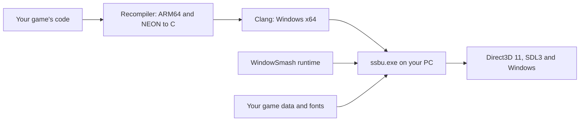

<p align="center">
  
</p>

<p align="center">
  <strong>Super Smash Bros. Ultimate as a native Windows program, built on your own PC from your own copy of the game.</strong>
</p>

<p align="center">
  <a href="docs/BUILDING.md"><strong>Setup guide</strong></a> ·
  <a href="docs/PLAYING.md"><strong>Playing</strong></a> ·
  <a href="docs/MULTIPLAYER.md"><strong>Multiplayer</strong></a> ·
  <a href="docs/DLC-AND-UNLOCKS.md"><strong>DLC &amp; unlocks</strong></a> ·
  <a href="docs/UPDATES.md"><strong>13.0.5 update</strong></a> ·
  <a href="docs/LINUX.md"><strong>Linux</strong></a> ·
  <a href="docs/MACOS.md"><strong>macOS</strong></a> ·
  <a href="docs/TECHNICAL.md"><strong>How it works</strong></a>
</p>

<p align="center">
  <a href="https://discord.gg/pkgyYGf3YB"></a>
</p>

---

> [!IMPORTANT]
> **This source code does not contain the game.** It has no game files, keys or firmware. You need your own copy of Super Smash Bros. Ultimate, dumped from your own Nintendo Switch. WindowSmash builds a Windows program from that copy, on your PC.
>
> **Your copy must be version 13.0.5**, the game's last update: for example the game together with its 13.0.5 update `.nsp`. [Which copies count](#game-version-1305).

## Contents

- [What is WindowSmash?](#what-is-windowsmash)
- [What you need](#what-you-need)
- [Install and play](#install-and-play)
- [Controls](#controls)
- [Play with friends](#play-with-friends)
- [All guides](#all-guides)
- [Project status](#project-status)
- [How it works](#how-it-works)
- [Community](#community)
- [Getting help](#getting-help)
- [For developers](#for-developers)
- [Legal](#legal)

## What is WindowSmash?

A Nintendo Switch and a Windows PC have different kinds of processors, so a Switch game can't run on a PC as it is. An emulator solves that by translating the game *while you play*. WindowSmash translates it **once, ahead of time**: it turns the game's code into C, compiles that into an ordinary Windows program, and adds a runtime that gives the game what it expects from a Switch: graphics, sound, controllers, files and networking.

The game itself still comes from your files. This repository holds only the translator (the *recompiler*) and the runtime.

**What you get**

- **Up to eight controllers**: Xbox, PlayStation, Switch Pro and most others, plus the keyboard.
- **Windowed, borderless or full screen**, always 16:9, with settings for G-Sync and FreeSync monitors.
- **Online play through Local Wireless**: rooms appear for every player in the online lobby, and nobody has to set up their router.
- **The game's own Online mode**, new and still being tested: Quickplay against WindowSmash's own game server.
- **Your DLC fighters**, and a tool that unlocks the base-game roster on your own save.
- **Game version 13.0.5**, the game's last update, which has every DLC fighter up to Kazuya and Sora.
- **An experimental Linux version**, built from the same source: `install-windowsmash.sh` sets it up on Linux in one go ([Linux](docs/LINUX.md)).
- **An experimental macOS version** for Macs with Apple silicon, built from the same source: `Install WindowSmash.command` sets it up on the Mac in one go ([macOS](docs/MACOS.md)).

## What you need

| | Requirement |
| :--- | :--- |
| **Computer** | A Windows 10 or Windows 11 PC, 64-bit. Experimental: a Linux PC ([Linux](docs/LINUX.md)), or a Mac with Apple silicon and macOS 14.5 or newer ([macOS](docs/MACOS.md)). |
| **Processor** | One with AVX2: an Intel Core i3, i5, i7 or i9 of the 4th generation (2013) or newer, or any AMD Ryzen. Most Pentium and Celeron processors don't have it. |
| **Graphics** | Any graphics card or chip that supports DirectX 11, with an up-to-date driver. |
| **Memory** | 16 GB recommended. |
| **Free space** | About 60 GB on the drive WindowSmash goes on, plus room for your game files (about 17 GB). |
| **Your game files** | Super Smash Bros. Ultimate from your own Switch (a game card dump, an `.nsp`, or the game installed in yuzu or Ryujinx) at **version 13.0.5** ([below](#game-version-1305)), with your console's keys and firmware. [Step 2](#step-2-have-your-game-files-ready) below says where to put them. |
| **Two free tools** | Python and a compiler. `Install WindowSmash.bat` installs them for you. |
| **Time** | About 15 minutes of your own time, plus a few minutes while the tools download and 30 minutes to a few hours while your PC builds the game. |

### Game version 13.0.5

WindowSmash plays **version 13.0.5** of the game, its last update, and no other. Any of these is 13.0.5:

- **The game and its 13.0.5 update** (an `.nsp`), side by side in one folder. The installer applies the update for you. The game as first released (1.0.0) is the best base: the update applies over it exactly. A game with an earlier update merged in works too.
- **The game installed in yuzu or Ryujinx, updated to 13.0.5.**
- **A dump with 13.0.5 merged in already.**

With any other version, the installer says so in red and doesn't build until the 13.0.5 update is in the game folder. One version for everyone means anyone can play with anyone, and every bug is found and fixed in the same game. The [13.0.5 update guide](docs/UPDATES.md) has the details, including what happens to a folder an older WindowSmash built from another version.

## Install and play

**`Install WindowSmash.bat` does the setup for you.** It installs the tools WindowSmash needs, finds your game files, and builds the game. Your part is to have your game files ready, start it, and choose a few things in one window. No programming knowledge is needed.

The whole journey at a glance:

| Step | What happens | Your time |
| :---: | :--- | :--- |
| **1** | **Check your PC** against [what you need](#what-you-need). | 2 minutes |
| **2** | **Have your game files ready**: the game, its 13.0.5 update and DLC, your keys and firmware. | 10 minutes |
| **3** | **Download WindowSmash** and extract it. | 5 minutes |
| **4** | **Start the installer**: double-click `Install WindowSmash.bat`. | 1 minute |
| **5** | **Let it install the tools** it needs: Python, a compiler and SDL3, if they are missing. | A few minutes, mostly waiting |
| **6** | **Choose your folders** and your online name in its setup window. | 5 minutes |
| **7** | **Wait while it builds the game.** | 30 minutes to a few hours |
| **8** | **Play.** Double-click the **Play SSBU** shortcut on your desktop. | |

### Step 1: Check your PC

Compare your PC with [what you need](#what-you-need) above. (**Settings → System → About** shows the system type, the installed RAM and the processor.) The installer checks too: if your PC lacks something, such as a processor with AVX2 or enough free space, it stops and says what.

### Step 2: Have your game files ready

**Played the game in yuzu or Ryujinx on this PC, updated to 13.0.5?** Then your files are ready: the installer finds your keys, your firmware and the installed game, with its update and DLC, by itself.

**Otherwise**, put your files in three folders. The names are examples; any folders will do:

| Folder | What goes in it |
| :--- | :--- |
| `D:\MyDump` | The game: a game card dump (`.xci`), an `.nsp`, or its `.nca` files. Its **13.0.5 update** `.nsp`, unless your dump has 13.0.5 merged in already. Your DLC `.nsp` files, loose or in a folder named `dlc`. |
| `D:\MyKeys` | `prod.keys` and `title.keys`, from your Switch. |
| `D:\MyFirmware` | Your Switch's firmware: a few hundred `.nca` files. WindowSmash takes the game's fonts from them. |

- **The game must be version 13.0.5** ([which copies count](#game-version-1305)). With the 13.0.5 update next to the game, the installer applies it for you; the game as first released (1.0.0) is the best base for it.
- **Compressed files** (`.nsz`, `.xcz`) have to be turned back into `.nsp` or `.xci` first.
- **Leave your game files where they are** after the install: depending on their kind, the game keeps reading its data from them.

### Step 3: Download WindowSmash

1. At the top of this page, click the green **Code** button, then **Download ZIP**.
2. Right-click `WindowSmash-main.zip`, choose **Extract All…**, pick a drive with about 60 GB free (for example `C:\`), and click **Extract**. You get a folder named `WindowSmash-main`; rename it to `WindowSmash` if you like.

> [!TIP]
> Keep WindowSmash out of the Desktop and Documents folders: OneDrive may try to upload them, and the finished build is around 30 GB. With [Git](https://git-scm.com/download/win), `git clone https://github.com/SNO2207/WindowSmash.git` does the same as the download.

### Step 4: Start the installer

1. Open the WindowSmash folder and double-click **`Install WindowSmash.bat`**.
2. Windows asks whether to run it (**The publisher could not be verified**): click **Run**. On some PCs a blue **Windows protected your PC** box comes instead: click **More info**, then **Run anyway**. Windows asks this once, about anything downloaded that isn't signed.

A window opens and shows each step as it goes. First it fetches the newest WindowSmash from GitHub, if there is a newer one, and checks your PC. Everything it shows is also kept in `install.log` in the WindowSmash folder.

### Step 5: Let it install the tools

The installer installs only what your PC is missing:

- **Python**, which runs WindowSmash's helper programs. If your PC has none, the installer puts a copy in the WindowSmash folder; nothing else on your PC changes.
- **A compiler**, which builds the game: LLVM's clang with Microsoft's C runtime and Windows SDK, downloaded into the WindowSmash folder (about 570 MB). Microsoft's parts come under Microsoft's license terms: the installer shows where to read them and asks whether you accept them; type `yes` and press <kbd>Enter</kbd>. If that download doesn't work, it installs the Visual Studio Build Tools instead, Microsoft's free tools: several gigabytes, with a progress window. Windows asks whether to allow the changes: click **Yes**. If it asks you to restart, do so, then double-click `Install WindowSmash.bat` again.
- **SDL3**, for PlayStation, Switch Pro and most other controllers.

Music and movies need nothing extra: their decoders come with WindowSmash and are built with the game.

### Step 6: Choose your folders

When the tools are ready, the setup window opens:

| Box | What to choose |
| :--- | :--- |
| **Game files** | `D:\MyDump`, or the yuzu or Ryujinx folder it found. |
| **Keys** | `D:\MyKeys`, or the one it found. |
| **Firmware** | `D:\MyFirmware`, or the one it found. |

Folders it found on your PC are filled in already; change any of them with **Browse…**. The line under each box says what is in the folder, for example *the game's update: 13.0.5* and *DLC: 99 add-on contents*. Green means it's fine; red says what's missing. If the game isn't version 13.0.5, the line says so: put the 13.0.5 update `.nsp` in the game folder and click **Check files**.

Then:

- Type your **online name**, the name other players see.
- Leave the three boxes ticked, or untick what you don't want: a **desktop shortcut**, a **Windows Firewall rule** for playing online (Windows asks for permission once), and **preparing the shaders** after the build.
- Click **Set up and build**.

### Step 7: Wait while it builds the game

First it prepares your game files, which takes a few minutes: it decrypts the game if needed and applies your update (up to about 17 GB more space). Then it builds the game: your PC translates it into a Windows program, which takes **30 minutes to a few hours**.

- A progress line shows how far the build has got and the time left. The time left appears once the first files are compiled, a few minutes in. The window's title shows it too, so you can follow it from the taskbar.
- You can keep using the PC, though it will be slower. Set it not to sleep while plugged in (**Settings → System → Power**) until the build is done.
- If the build stops (a restart, the PC going to sleep, an error you fixed), double-click `Install WindowSmash.bat` again: it carries on where it stopped.
- It's finished when the window says **Done**. Press a key to close it.

### Step 8: Play

Double-click the **Play SSBU** shortcut on your desktop, or `Play SSBU.bat` in the WindowSmash folder.

- A small window called **SSBU log** opens minimized next to the game. Leave it: it closes with the game.
- If Windows Security asks whether to allow `ssbu.exe` on networks, allow it: it's needed for playing online.
- The first start takes a little longer. If you left *preparing the shaders* ticked, it runs in its own window at low priority; until it's done, some effects can stutter the first time they appear.

Then see the [controls](#controls) and how to [play with friends](#play-with-friends) below. The [playing guide](docs/PLAYING.md) covers settings, saves and screenshots.

### Updating WindowSmash

Double-click `Install WindowSmash.bat` again. It downloads the newest WindowSmash from GitHub if there is one, and builds again, which takes minutes rather than hours. Your game files, settings, save and online name stay as they are.

A folder an older WindowSmash built from another game version, such as 11.0.0, is set up again as 13.0.5 once your game folder has the 13.0.5 update; your save and settings stay. See [a folder built from another version](docs/UPDATES.md#a-folder-built-from-another-version).

### If something goes wrong

The installer stops with a message saying what went wrong and what to do; `install.log` keeps everything it showed. [If something goes wrong](docs/BUILDING.md#if-something-goes-wrong) in the setup guide lists the usual problems, and [getting help](#getting-help) says where to ask. Prefer to set it up yourself, step by step? The [setup guide](docs/BUILDING.md) has every step by hand.

<details>
<summary><strong>Already know your way around? The short version</strong></summary>

<br>

You need Windows 10/11 x64. `Install WindowSmash.bat` installs Python 3.10 or newer and a compiler when they are missing: LLVM's clang-cl with Microsoft's C runtime and Windows SDK in `deps` (`tools\msvc_deps.py`, after you accept Microsoft's license terms), or the Visual Studio Build Tools with **C++ Clang tools for Windows** if that fails (`-BuildTools` goes straight to them). `-NoWizard` asks its questions in the console instead of the setup window, with the folders you give as the answers to accept. The example paths are your game files in `D:\MyDump` (the game with its 13.0.5 update), your keys in `D:\MyKeys` and your firmware in `D:\MyFirmware`.

```powershell
git clone https://github.com/SNO2207/WindowSmash.git
cd WindowSmash
& ".\Install WindowSmash.bat" -Game "D:\MyDump" -Keys "D:\MyKeys" -Firmware "D:\MyFirmware" -NoWizard
```

With Python and the build tools already installed, `tools/build_game.py` does the build on its own:

```powershell
python tools/build_game.py --game "D:\MyDump" --keys "D:\MyKeys" --firmware "D:\MyFirmware"
& ".\Play SSBU.bat"
```

`-DryRun` makes the installer say what each step would do without doing it. The setup guide has the [manual commands](docs/BUILDING.md#quick-version) and a [reference section](docs/BUILDING.md#reference) on DLC, SDL3, the codecs and the folder layout.

</details>

## Controls

Plug in a controller and press a button: each pad becomes the next free player, up to eight. The keyboard plays as player 1.

| Switch button | Keyboard |
| :--- | :--- |
| Left stick | Arrow keys |
| A / B / X / Y | <kbd>Z</kbd> / <kbd>X</kbd> / <kbd>C</kbd> / <kbd>V</kbd> |
| L / R | <kbd>A</kbd> / <kbd>S</kbd> |
| ZL / ZR | <kbd>Q</kbd> / <kbd>W</kbd> |
| + / − | <kbd>Enter</kbd> / <kbd>Backspace</kbd> |
| Right stick | <kbd>I</kbd> <kbd>J</kbd> <kbd>K</kbd> <kbd>L</kbd> |

| Key | What it does |
| :--- | :--- |
| <kbd>F1</kbd> | Show or hide the overlay (frame rate, online status). |
| <kbd>F2</kbd> | Show more details, including the connected pads. |
| <kbd>F3</kbd> | Take a screenshot (saved in the `screenshots` folder). |
| <kbd>F11</kbd> or <kbd>Alt</kbd>+<kbd>Enter</kbd> | Switch between a window and full screen. |

> [!NOTE]
> Buttons go by **position**, as on a Switch controller. On an Xbox controller, the right-hand button (**B**) is the Switch's **A**. To use the printed letters instead, or to remap anything, see [Playing: controllers](docs/PLAYING.md#controllers). PlayStation, Switch Pro and most other pads need SDL3, which [step 12](docs/BUILDING.md#step-12-optional-support-more-kinds-of-controllers) of the setup guide adds.

## Play with friends

| Way | For | How |
| :--- | :--- | :--- |
| **Online lobby** (the default) | Anyone, anywhere | Double-click `Play SSBU.bat`, open **Local Wireless** in the game, then create a room or pick one from **Rooms List**. |
| **Lobby code** | Friends only, through the online lobby | Everyone adds the same code to `online_server.txt`. Only players with that code see your rooms. |
| **Private room** | A group with one host | The host runs `launchers\Host SSBU Netplay.bat`; the others run `launchers\Join SSBU Netplay.bat` and type the host's address. |

Everyone runs game version **13.0.5**, so anyone can play with anyone. Each PC uses its own save. The [multiplayer guide](docs/MULTIPLAYER.md) walks through each way and what to do when a room doesn't show up.

Looking for people to play with? Ask on the [Discord server](https://discord.gg/pkgyYGf3YB).

## All guides

| Guide | Read it to |
| :--- | :--- |
| [Setup guide](docs/BUILDING.md) | install WindowSmash and build the game, step by step. |
| [Playing](docs/PLAYING.md) | change the controls or the window, and find saves, screenshots and problem reports. |
| [Multiplayer](docs/MULTIPLAYER.md) | play with other people online or in a private room. |
| [DLC and unlocks](docs/DLC-AND-UNLOCKS.md) | use your DLC, or unlock every base-game fighter on your save. |
| [The 13.0.5 update](docs/UPDATES.md) | see which copies of the game count as 13.0.5, how the update is applied, and what happens to a folder built from another version. |
| [Linux](docs/LINUX.md) | install, build and run the experimental Linux version. |
| [macOS](docs/MACOS.md) | install, build and run the experimental version for Macs with Apple silicon. |
| [Runtime packages](docs/RUNTIME-SETUP.md) | set up a ready-built runtime package with your own game data. |
| [How it works](docs/TECHNICAL.md) | understand the recompiler, the runtime and every tool. |
| [Third-party notices](NOTICE.md) | see attributions and licenses. |

## Project status

WindowSmash is **experimental**. Menus and matches run and Local Wireless connects, but much of it hasn't been tested widely yet.

| Area | Where it stands |
| :--- | :--- |
| **Game version** | **13.0.5** only. Its menus and full roster have been checked, its matches less so. |
| **CPU and loading** | The game's code is translated to C ahead of time; fighter modules are compiled too and loaded when the game asks for them. |
| **Graphics** | Direct3D 11. Shaders compile the first time each is used, so a new effect can hitch once. `launchers\Prepare Shaders.bat` can compile them ahead of time. |
| **Controllers** | Up to eight players on most pads, plus the keyboard. Testing with real pads has been limited so far. |
| **Display** | Windowed, borderless or full screen, kept 16:9, with pacing for fixed-refresh and variable-refresh monitors. |
| **Audio and movies** | Music (Opus) and movies (VP9) are decoded by libopus and libvpx, built from the sources that come with WindowSmash. |
| **DLC** | Every DLC fighter you own, Kazuya and Sora included: 13.0.5 has them all. |
| **Multiplayer** | The online lobby (with direct connections) and private rooms work. Complete matches between two PCs, and the whole roster online, haven't been fully verified. |
| **Linux** | Experimental, built from the same source and drawn through DXVK on Vulkan: on Linux itself with `install-windowsmash.sh`, or cross-compiled on Windows. |
| **macOS** | Experimental: Macs with Apple silicon and macOS 14.5 or newer, built on the Mac itself with `Install WindowSmash.command` and drawn by a Metal renderer of its own. **13.0.5** has been checked through its opening and menus at 60 fps; matches haven't been yet. |

There is no connection to Nintendo's online service, no claim of general Switch compatibility, and no verified performance target.

## How it works



The recompiler finds every function in the game's ARM64 code and writes it out as C. Clang compiles that C for Windows, and it is linked with the runtime, which stands in for the parts of the Switch the game talks to. The game's graphics commands go to Direct3D 11, its shaders are translated to HLSL, and its Local Wireless traffic travels over the internet through a relay.

The **[technical guide](docs/TECHNICAL.md)** explains each part: the CPU model, function discovery, symbol binding, the services, the graphics path, shader compilation, the network protocol, save handling, and every tool in `tools/`.

## Community

<a href="https://discord.gg/pkgyYGf3YB"></a>

Join the **[recomps.wtf Discord server](https://discord.gg/pkgyYGf3YB)** to:

- get help with setting up and building;
- find people to play with online;
- share how the game runs on your PC;
- follow development and new releases.

## Getting help

When something goes wrong, first look at [If something goes wrong](docs/BUILDING.md#if-something-goes-wrong) in the setup guide. For a quick question, ask on [Discord](https://discord.gg/pkgyYGf3YB). To report a problem, open an issue and include:

- your Windows version, and your graphics card and driver version;
- which WindowSmash you have (the date you downloaded it, or the output of `git rev-parse --short HEAD`);
- what you did, what you expected, and what happened instead;
- after a crash or a freeze, the `.txt` report from the `reports\` folder, and the end of `build\play.log`.

> [!WARNING]
> Logs and reports can contain your folder names, player names and internet addresses. Read them before posting. A crash report's `.dmp` file contains part of the game's memory: share it only privately, with someone who asked for it. Never post game files, keys, saves or generated game code in issues or pull requests.

## For developers

Run the source-only tests. They use made-up data, need no game files, and don't start the game:

```powershell
python -m pip install -r tests/requirements-dev.txt
python -m unittest discover -s tests -v
```

The game-backed instruction and function tests are in the [technical guide](docs/TECHNICAL.md#verification-and-debugging).

| Folder | Contents |
| :--- | :--- |
| `launchers/` | The other launchers: offline play, private rooms, shader preparation, the unlock tool, building without the installer. |
| `runtime/` | The native runtime: services, graphics, input, audio, networking. |
| `tools/` | The recompiler, game-file readers and launch helpers; `tools/dev/` holds the developers' analysis and test tools, `tools/linux/` the Linux build, `tools/mac/` the macOS build, installer and launchers. |
| `tests/` | Source-only tests. |
| `third_party/` | The sources of libopus and libvpx's VP9 decoder, built during the build, with their license texts. |
| `docs/` | These guides. |

Everything generated or personal stays out of Git: `build/`, `dump/`, `deps/`, `save/`, caches, captures and reports.

## Legal

No project-wide license has been chosen for the WindowSmash source yet; see the [third-party notices](NOTICE.md) for the parts that have their own. Super Smash Bros. Ultimate and related names belong to their respective owners. WindowSmash is an independent project and is not affiliated with or endorsed by Nintendo.
